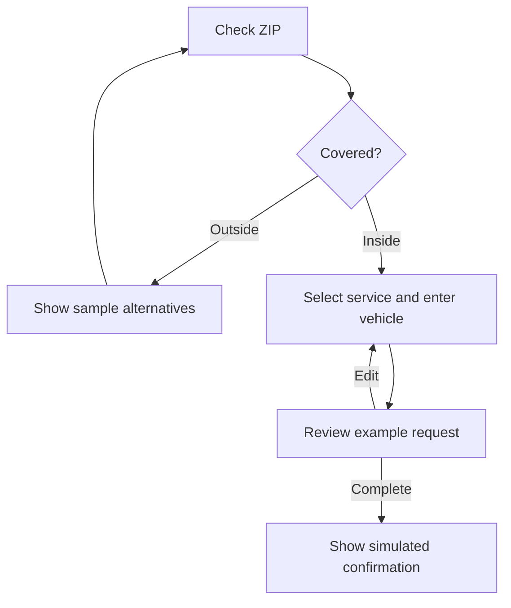

# Bolt & Borough MVP wireframes

| Area | Desktop | Phone |
| --- | --- | --- |
| Header | Brand left, services/fleet/support center, ZIP action right | Brand and ZIP action in the first row, 3 navigation links in the second |
| Hero | Promise and actions left, contextual van image right | Promise and actions, followed by the van image |
| Service catalog | Four service cards with scope, demo range and selection link | Two cards on wider phones, one per row on narrow phones |
| Booking | Brief and sample ZIPs left, active form and status right | Brief, ZIP and status, service/vehicle/window, review or simulated success |
| Fleet | Commercial offer left, inquiry right | Offer followed by its short form |
| Support | Context left, native FAQ disclosures right | Context followed by disclosures |

Service links preselect an option while retaining the ZIP gate. Native labels, forms, validation and disclosures keep familiar browser interactions. Review and completion focus headings so keyboard users have a clear landing point.
